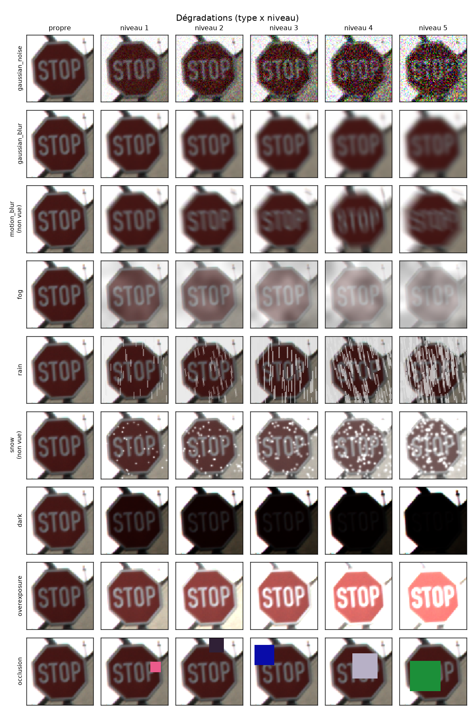

# Reconnaissance de panneaux de signalisation en conditions visuelles dégradées avec ResNet

Un classifieur de panneaux entraîné sur des images propres perd vite en précision dans le brouillard, la pluie, la nuit ou à contre-jour. Ce projet mesure cette perte et teste trois façons de la réduire avec un ResNet pré-entraîné sur ImageNet :

1. **augmentation par dégradations** pendant l'entraînement (modèle *robust*), en gardant deux dégradations hors entraînement pour tester la généralisation ;
2. **adaptation des statistiques BatchNorm au test**, sans étiquettes ni réentraînement ;
3. **Grad-CAM**, pour voir où le réseau regarde quand l'image se dégrade.

Le notebook [`notebooks/colab_train.ipynb`](notebooks/colab_train.ipynb) exécute tout de bout en bout sur un GPU T4 Google Colab, depuis VS Code.



---

## Jeu de données : GTSRB

[German Traffic Sign Recognition Benchmark](https://benchmark.ini.rub.de/gtsrb_dataset.html) (Stallkamp et al., 2012), téléchargé par `torchvision.datasets.GTSRB(download=True)` :

| | Images | Remarques |
|---|---|---|
| Entraînement | 26 640 | 43 classes, 888 *tracks* de 30 images (version `GTSRB-Training_fixed` distribuée par torchvision) |
| → train / val | 23 880 / 2 760 | split par track, 10 % des tracks de chaque classe en validation |
| Test | 12 630 | jeu de test officiel |

- Les images (de 15×15 à 250×250 px) sont redimensionnées en **64×64**, puis converties par `ToImage` + `ToDtype(float32, scale=True)` en tenseurs dans $[0,1]$.
- **Validation par track.** Chaque *track* regroupe 30 images du **même panneau physique** filmé à des distances différentes. Un split aléatoire image par image mettrait des quasi-doublons en train et en val et gonflerait la précision de validation. Ici, 10 % des tracks de chaque classe partent en validation (`src/data.py:track_split`, avec une assertion d'absence de fuite).
- **Augmentations classiques légères** : rotation ±10°, `ColorJitter` (luminosité, contraste, saturation 0,3, teinte 0,02). **Pas de flip horizontal** : il transforme « tourner à gauche » en « tourner à droite ».

## Dégradations

Implémentées en PyTorch pur dans [`src/corruptions.py`](src/corruptions.py), sans `imagecorruptions`. Elles s'appliquent **sur GPU à des batchs entiers** et ont toutes la signature `corrupt(x, kind, severity) -> x`, avec $x \in [0,1]^{B\times 3\times H\times W}$, $s \in \{1,\dots,5\}$, et une sortie toujours ramenée dans $[0,1]$ par $\mathrm{clip}$. Un `torch.Generator` optionnel les rend reproductibles : tous les modèles sont évalués sur exactement les mêmes images dégradées. Les tailles en pixels sont données pour du 64×64 et mises à l'échelle pour d'autres résolutions.

| Type | Formule | Paramètre, niveaux 1 → 5 |
|---|---|---|
| `gaussian_noise` | $x' = x + \sigma\,\varepsilon,\ \varepsilon \sim \mathcal N(0, I)$ | $\sigma$ = 0,04 · 0,08 · 0,12 · 0,17 · 0,23 |
| `gaussian_blur` | $x' = x * G_\sigma,\ G_\sigma(u) \propto e^{-u^2/2\sigma^2}$ (séparable) | $\sigma$ = 0,6 · 0,9 · 1,2 · 1,6 · 2,0 px |
| `motion_blur` | $x' = x * K_{L,\theta}$ : segment de longueur $L$, $\theta \sim \mathcal U[0,\pi)$ par image | $L$ = 3 · 5 · 7 · 9 · 12 px |
| `fog` | $x' = (1-t)\,x + t\,V$, voile $V = \mathrm{clip}\big(0{,}75 + 0{,}12\,(\uparrow Z_4 + \tfrac12 \uparrow Z_8)\big)$ | $t$ = 0,30 · 0,42 · 0,54 · 0,65 · 0,75 |
| `rain` | $S = \mathrm{clip}(M * \ell_{L,\theta})$, $M \sim \mathcal B(\rho)$, $\theta = 90° \pm 15°$ ; $x' = (1-d)\,x\,(1-\beta S) + 0{,}9\,\beta S$ | $(\rho, L, \beta, d)$ de (0,010 ; 6 ; 0,45 ; 0,05) à (0,040 ; 14 ; 0,78 ; 0,20) |
| `snow` | $\tilde x = (1-w)\,x + w\max(x,\,1{,}5\,Y + 0{,}5)$ ; $F = \mathrm{clip}\big(2\pi\sigma^2\,(M \odot U) * G_\sigma\big)$ ; $x' = 1 - (1-\tilde x)(1-F)$ | $(\rho, \sigma, w)$ de (0,010 ; 0,6 ; 0,10) à (0,045 ; 1,0 ; 0,42) |
| `dark` | $x' = x^{\gamma}$ (gamma) | $\gamma$ = 1,6 · 2,2 · 2,8 · 3,5 · 4,5 |
| `overexposure` | $x' = g\,x + b$ : tout pixel au-dessus de $(1-b)/g$ sature à 1 | $(g, b)$ = (1,40 ; 0,05) · (1,75 ; 0,10) · (2,10 ; 0,15) · (2,60 ; 0,20) · (3,20 ; 0,25) |
| `occlusion` | $x' = (1-M) \odot x + M \odot c$ : carré de côté $r \cdot 64$ px, position aléatoire, couleur $c \sim \mathcal U[0,1]^3$ | $r$ = 0,15 · 0,22 · 0,30 · 0,38 · 0,46 (2 % à 21 % de la surface) |

Notations : $*$ convolution (par canal, bords en réflexion), $\uparrow Z_k$ bruit gaussien $k\times k$ interpolé en bicubique à la taille de l'image, $Y$ luminance, $M$ masque de Bernoulli, $U \sim \mathcal U[0{,}6;1]$ intensité des flocons, $\ell_{L,\theta}$ segment non normalisé (traînées). Toutes les valeurs intermédiaires sont dans le dictionnaire `PARAMS` de `src/corruptions.py`.

`python -m src.corruptions --grid` produit la grille type × niveau ci-dessus (`results/corruption_grid.png`).

## Architecture : ResNet

Un ResNet (He et al., 2016) empile des **blocs résiduels**. Au lieu d'apprendre directement une transformation $H(x)$, chaque bloc apprend un résidu $F(x) = H(x) - x$ :

$$
y = F(x, \{W_i\}) + x
$$

Quand les dimensions changent (stride 2, plus de canaux), le raccourci devient une projection : $y = F(x) + W_s x$ (convolution 1×1 + BN). Le terme identité laisse le gradient traverser le réseau sans atténuation, $\frac{\partial \mathcal L}{\partial x} = \frac{\partial \mathcal L}{\partial y}\big(1 + \frac{\partial F}{\partial x}\big)$, ce qui permet d'entraîner des réseaux profonds.

- **ResNet-18** (défaut) : blocs *basic*, deux convolutions 3×3 (conv-BN-ReLU-conv-BN, puis addition et ReLU), [2, 2, 2, 2] blocs, 11,2 M paramètres.
- **ResNet-50** (`--model resnet50`) : blocs *bottleneck* 1×1 → 3×3 → 1×1, [3, 4, 6, 3] blocs, 23,6 M paramètres.

Adaptations dans [`src/models.py`](src/models.py) :

| Choix | Pourquoi |
|---|---|
| Poids ImageNet, `fc` remplacée par `Linear(·, 43)` | apprentissage par transfert |
| `Normalize(mean, std ImageNet)` **dans** le modèle | le modèle reçoit des images dans $[0,1]$ : les dégradations s'appliquent dans l'espace des pixels, avant la normalisation, et le checkpoint est autonome |
| `maxpool` supprimé (`remove_maxpool: true`) | à 64×64, `layer4` sort en **4×4** au lieu de 2×2 : plus de résolution spatiale, et des cartes Grad-CAM lisibles |

## Méthodologie

| | Baseline (`configs/baseline.yaml`) | Robust (`configs/robust.yaml`) |
|---|---|---|
| Données | images propres + augmentations légères | idem + **dégradations aléatoires** |
| Dégradations à l'entraînement | aucune | avec $p = 0{,}5$ par batch : un type et un niveau tirés au hasard parmi 7 types × 5 niveaux |
| Dégradations **non vues** | toutes | `snow` et `motion_blur` (jamais utilisées à l'entraînement) |

**Hyperparamètres communs** : AdamW (weight decay 0,05), OneCycleLR (max_lr $10^{-3}$, 20 % de montée), précision mixte AMP (`torch.amp.autocast("cuda")` + `GradScaler`), label smoothing 0,1, 15 époques, batch 256, `num_workers=2`, `pin_memory`. Le meilleur modèle est retenu sur la précision de validation (images propres).

**Généralisation aux dégradations non vues.** `snow` mélange blanchiment et taches claires ; `motion_blur` est un flou directionnel. Comparer la mCE du modèle robust sur les types vus et sur ces deux types non vus permet de savoir s'il a appris une robustesse générale ou s'il a seulement mémorisé les dégradations d'entraînement.

**Adaptation BatchNorm au test** ([`src/bn_adapt.py`](src/bn_adapt.py), Schneider et al., 2020). En inférence, la BN normalise avec la moyenne et la variance $(\mu, \sigma^2)$ estimées sur les images propres d'entraînement. Une dégradation déplace la distribution des activations, et ces statistiques ne correspondent plus. Pour chaque (type, niveau), on part du modèle entraîné, on remet `running_mean` et `running_var` à zéro, on passe **uniquement les couches BN** en mode train (moyenne cumulative, `momentum=None`), on fait des forwards **sans gradient** sur 2 048 images dégradées non étiquetées, puis on réévalue en mode eval. Aucun poids n'est modifié et aucune étiquette n'est utilisée.

**Grad-CAM** ([`src/gradcam.py`](src/gradcam.py), Selvaraju et al., 2017). Implémenté par hooks sur `layer4` : un hook avant capture les activations $A^k$, un hook sur leur tenseur capture $\partial y^c / \partial A^k$, puis

$$
\alpha_k^c = \frac{1}{Z}\sum_{i,j} \frac{\partial y^c}{\partial A^k_{ij}}, \qquad L^c_{\text{Grad-CAM}} = \mathrm{ReLU}\Big(\sum_k \alpha_k^c A^k\Big)
$$

La carte est interpolée à 64×64 et superposée à l'image : panneau propre et dégradé, baseline et robust.

**Reproductibilité** : seed fixe (Python, NumPy, PyTorch, générateur du DataLoader réinitialisé à chaque époque), configs YAML, arguments `--config --resume --epochs --model`, sorties dans `results/<nom_run>/`. Un checkpoint `last.pt` (modèle, optimiseur, scheduler, GradScaler, états RNG) est écrit de façon atomique à chaque époque, et `best.pt` à chaque amélioration de la val acc.

## Métriques

| Métrique | Définition |
|---|---|
| Précision | $\mathrm{Acc} = \frac{1}{n}\sum_i \mathbb 1[\hat y_i = y_i]$, sur images propres et pour chaque dégradation $c$ et niveau $s$ : $\mathrm{Acc}_{c,s}$ |
| Erreur | $E_{c,s} = 1 - \mathrm{Acc}_{c,s}$ |
| Corruption Error | $\mathrm{CE}_c = \dfrac{\sum_{s=1}^{5} E_{c,s}^{\text{modèle}}}{\sum_{s=1}^{5} E_{c,s}^{\text{baseline}}}$ (Hendrycks & Dietterich, 2019) |
| mCE | $\mathrm{mCE} = \frac{1}{\lvert C \rvert}\sum_{c \in C} \mathrm{CE}_c$, aussi calculée séparément sur les types vus et non vus |
| ECE (15 bins) | $\mathrm{ECE} = \sum_{b=1}^{15} \frac{\lvert B_b \rvert}{n}\,\big\lvert \mathrm{acc}(B_b) - \mathrm{conf}(B_b) \big\rvert$, où $B_b$ regroupe les prédictions dont la confiance $\max_k p_k$ tombe dans le bin $b$ |

La baseline a une mCE de 100 % par définition. En dessous de 100 %, le modèle se trompe moins que la baseline sous dégradation. L'ECE mesure l'écart entre la confiance affichée et la précision réelle (0 = parfaitement calibré). Le script produit aussi les matrices de confusion sur les images propres et au niveau 5 (toutes dégradations réunies).

## Exécution sur Google Colab depuis VS Code

Le code tourne sur un serveur Colab distant. Le notebook télécharge tout lui-même : code (git clone), dépendances, GTSRB et poids ImageNet. Google Drive n'est pas utilisé, car il ne peut pas être monté depuis l'extension VS Code.

1. **Pousser ce dépôt sur GitHub.** Un dépôt public est le plus simple. Pour un dépôt privé, définissez `GITHUB_TOKEN` dans le notebook avant la cellule 2.
2. Dans VS Code, installer les extensions **Google Colab** (éditeur : Google) et **Jupyter**.
3. Ouvrir `notebooks/colab_train.ipynb`.
4. En haut à droite : **Select Kernel → Colab → New Colab Server → GPU → T4**, donner un nom au serveur, puis se connecter avec son compte Google.
5. Dans la cellule 2, remplacer `REPO_URL` par l'URL de votre dépôt.
6. Exécuter les cellules dans l'ordre (ou **Run All**). La cellule 1 s'arrête avec un message clair si aucun GPU n'est disponible.

**Coupure de session.** Relancez la cellule 2 (elle fait un `git pull` si le dépôt existe déjà), puis la cellule d'entraînement interrompue : `--resume` reprend à l'époque qui suit le dernier `last.pt`. Si le run est terminé, la cellule s'arrête immédiatement.

> ⚠️ Les fichiers du serveur (`/content`) survivent à une déconnexion ou à un redémarrage du noyau, **pas au recyclage de la VM**. Pour s'en protéger sans Drive, définissez `HF_TOKEN` et `HF_REPO_ID` (lignes commentées en tête de la cellule 4). `last.pt`, `best.pt` et `metrics.csv` sont alors copiés sur un dépôt **privé** du Hugging Face Hub à chaque époque, et `--resume` les y récupère si le disque local est vide.

**Récupérer les résultats.** Les figures et tableaux s'affichent dans le notebook, et ces sorties sont enregistrées dans votre fichier `.ipynb` local. La cellule 9 crée `results.zip` (sans les `.pt`, sauf `best.pt`), et la cellule optionnelle suivante l'envoie sur le Hub (token lu depuis `HF_TOKEN`, jamais écrit en dur). `google.colab.files.download` ne fonctionne pas dans VS Code.

### Exécution locale (optionnelle)

```bash
pip install -r requirements.txt
python -m src.data --examples
python -m src.train --config configs/baseline.yaml
python -m src.train --config configs/robust.yaml
python -m src.evaluate --runs baseline robust --baseline baseline --update-readme
python -m src.bn_adapt --runs baseline robust --update-readme
python -m src.gradcam --runs baseline robust
```

Smoke test CPU (quelques minutes) : `python -m src.train --config configs/baseline.yaml --epochs 1 --subset 512 --batch-size 128`, puis `python -m src.evaluate --corruptions gaussian_noise fog --severities 1 5 --max-samples 512`.

## Structure du dépôt

```
traffic-sign-robust-resnet/
├── README.md
├── requirements.txt
├── configs/
│   ├── baseline.yaml       # entraînement sur images propres
│   └── robust.yaml         # entraînement avec augmentation par dégradations
├── src/
│   ├── data.py             # GTSRB (torchvision), split par track, DataLoaders, cache du test
│   ├── corruptions.py      # 9 dégradations × 5 niveaux sur GPU, grille d'exemples
│   ├── models.py           # ResNet-18/50 ImageNet, fc -> 43 classes, Normalize intégré
│   ├── train.py            # AdamW + OneCycleLR + AMP, checkpoints, --resume
│   ├── evaluate.py         # Acc, CE, mCE, ECE, matrices de confusion, figures, tableaux
│   ├── bn_adapt.py         # adaptation des statistiques BatchNorm au test
│   ├── gradcam.py          # Grad-CAM par hooks sur layer4
│   └── utils.py            # seed, logging, checkpoints, métriques, Hub
├── notebooks/
│   └── colab_train.ipynb   # exécution de bout en bout sur Colab
└── results/                # figures et tableaux générés (les .pt sont ignorés par git)
    ├── <nom_run>/          # config.yaml, train.log, metrics.csv, curves.png, last.pt, best.pt, eval.json
    ├── figures/            # acc_vs_severity, heatmaps, confusion, training_curves, bn_adapt, gradcam
    ├── robustness_table.csv / .md
    └── bn_adapt_table.csv / .md
```

## Résultats

Cette section est remplie automatiquement par `python -m src.evaluate --update-readme` (cellule 6) et `python -m src.bn_adapt --update-readme` (cellule 7).

### Robustesse aux dégradations

<!-- RESULTS:START -->
_En attente : lancez `python -m src.evaluate --runs baseline robust --baseline baseline --update-readme`._

| Modèle | Acc. propre | Acc. moy. dégradée | mCE | mCE (vues) | mCE (non vues) | ECE propre | ECE dégradée |
|---|---|---|---|---|---|---|---|
| baseline | … | … | 100 % | … | … | … | … |
| robust | … | … | … | … | … | … | … |
<!-- RESULTS:END -->

### Adaptation BatchNorm au test

<!-- BN_ADAPT:START -->
_En attente : lancez `python -m src.bn_adapt --runs baseline robust --update-readme`._
<!-- BN_ADAPT:END -->

### Grad-CAM

Figures générées par `python -m src.gradcam` : `results/figures/gradcam_fog_s4.png` et `results/figures/gradcam_snow_s4.png`.

## Références

- J. Stallkamp, M. Schlipsing, J. Salmen, C. Igel. *Man vs. computer: Benchmarking machine learning algorithms for traffic sign recognition*. Neural Networks, 2012.
- K. He, X. Zhang, S. Ren, J. Sun. *Deep Residual Learning for Image Recognition*. CVPR, 2016.
- D. Hendrycks, T. Dietterich. *Benchmarking Neural Network Robustness to Common Corruptions and Perturbations*. ICLR, 2019.
- S. Schneider, E. Rusak, L. Eck, O. Bringmann, W. Brendel, M. Bethge. *Improving robustness against common corruptions by covariate shift adaptation*. NeurIPS, 2020.
- R. R. Selvaraju et al. *Grad-CAM: Visual Explanations from Deep Networks via Gradient-based Localization*. ICCV, 2017.
- C. Guo, G. Pleiss, Y. Sun, K. Q. Weinberger. *On Calibration of Modern Neural Networks*. ICML, 2017.
